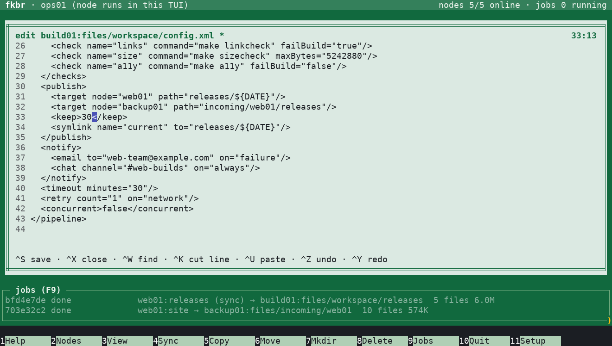
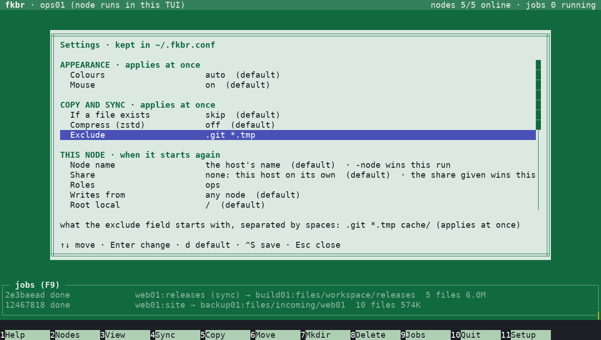

# fkbr

fkbr copies and syncs files between Linux hosts that share only an NFS
mount, or that one of them reaches with ssh. Over a share the hosts never
connect to each other: requests and data pass through a directory on it.
It ships as a single static binary with a dual-pane TUI and a scriptable
CLI.

**Faster than tar and rsync.** Measured in the lab, every copy checked.

**Through an NFS share:**

| | fkbr | tar | rsync |
|---|---|---|---|
| 20,000 small files → 1 host | **5.6 s** | 6.5 s | 2 min 16 s (**24× slower**) |
| 200,000 small files → 1 host | **27 s** | 31 s | 22 min 44 s (**50× slower**) |
| 1 GiB file → 3 hosts | **32 s** | 38 s | 38 s |

rsync through NFS waits on the server for every file; fkbr packs small
files into big chunks.

**Over ssh, without a share:**

| | fkbr | rsync |
|---|---|---|
| 20,000 small files → 3 hosts | **6.1 s** | 9.5 s |
| 200,000 small files → 3 hosts | **46 s** | 1 min 8 s |

All the numbers: `docs/benchmarks.md`.

## Features

- **Nothing to install.** One static binary for x86-64 or ARM64. It runs
  on any Linux with kernel 3.10 or newer and does not depend on glibc. No
  package, service, system user or files in `/etc`.
- **Over ssh too.** Hosts without a common share, reached with ssh, are
  linked from one of them: `fkbr ssh:web01:/srv/www,db01`, or with F7 in
  the TUI (kept in the config file). Data goes straight from source to
  target (`docs/ssh.md`).
- **On its own.** `fkbr` with no share opens the TUI in the directory you
  are in and in `/`, which only you see.
- **No master.** Each host that runs `fkbr /mnt/nfs/xfer` joins as a node
  named after its hostname. Copy to one node, a list of nodes, or all of
  them (`@all`).
- **Fan-out.** Data is staged on the share once and read by every target.
  Slow or offline targets are detached and can catch up later.
- **Dual-pane TUI** in the style of Norton Commander. Either pane browses
  any node; copy, move, sync, view, edit, create and delete work on any
  node, with live job progress.
- **Full mouse support.** Click to move, double-click to open, right-click
  to mark (or drag to mark several), and scroll with the wheel or drag
  the scrollbars. The function key bar and every dialog option are
  clickable. Hold Shift to select text, or start with `-mouse=false`.
- **Sync** in one direction, incremental or mirror, over millions of files
  with flat memory use. Every sync is planned as a dry run you confirm.
  Excludes, keep-newer and a delete limit protect the target.
- **Fast.** Faster than tar, rsync and borg through the same share in
  every lab test, most of all with many small files or several targets;
  over ssh as fast as rsync or faster (`docs/benchmarks.md`).
- **Crash-safe.** Atomic writes on the share, checksummed chunks and
  resumable jobs. Files are installed only after the whole transfer has
  arrived. Tested by killing, freezing and restarting nodes mid-transfer,
  cutting hosts off the NFS server, and deleting parts of the share under
  running nodes: over 12,000 copies checked, no file ever lost or
  corrupted (`docs/stability.md`).

## Screenshots

Five nodes on one share. Two files are marked on web01 (left); backup01
(right) holds an earlier copy of web01's site.


**Copy (F5).** The destination defaults to the other pane, or to the
nodes marked with Insert in a node list (`@dest`). Type `n1,n2` for a
list, or press Ctrl+A for all nodes. Excludes are optional.


**Sync (F4).** Makes the other side match this pane: the whole folder, or
only the marked folders. Every sync starts as a dry run that shows what
each target would copy, replace and delete; nothing changes until you
confirm. Here web01's site is mirrored to all four other nodes, and
backup01 would lose a page the site no longer has.


**Jobs (F9).** Either pane can show any node. The jobs panel lists running
and finished jobs.


**Job details (Enter).** Progress, rate and ETA, and what each node is
doing, updated live.


**View and edit (F3).** Shows a file from any node, with XML, JSON, YAML,
shell scripts and Python highlighted; Ctrl+W finds, and Ctrl+E edits it
in place with nano's keys (save, cut and paste lines, undo, find).




**Settings (F11).** Colours and five themes (green, blue, red, yellow,
black), mouse, what the copy dialogs start with, this node's name, share
and limits, kept in `~/.fkbr.conf`; only what you change is written.



**F1** lists every key.

## Download

One self-contained binary per architecture, for any Linux with kernel
3.10 or newer (CentOS 7 and up). No libraries, nothing to install:

- **x86-64:**
  [fkbr-linux-amd64.tar.gz](https://github.com/grajsor/fkbr/releases/latest/download/fkbr-linux-amd64.tar.gz)
  or [.zip](https://github.com/grajsor/fkbr/releases/latest/download/fkbr-linux-amd64.zip)
- **ARM64**, such as a Raspberry Pi 3, 4 or 5 with a 64-bit OS, and newer:
  [fkbr-linux-arm64.tar.gz](https://github.com/grajsor/fkbr/releases/latest/download/fkbr-linux-arm64.tar.gz)
  or [.zip](https://github.com/grajsor/fkbr/releases/latest/download/fkbr-linux-arm64.zip)

Checksums and older versions are on the
[releases page](https://github.com/grajsor/fkbr/releases). Unpack it
where it should live:

```
tar -xzf fkbr-linux-amd64.tar.gz    # fkbr, LICENSE, README.md
```

Or build it yourself with Go 1.26 or newer. `make` cross-compiles both
architectures, `make release` also packs them:

```
make            # dist/fkbr-linux-amd64 and dist/fkbr-linux-arm64
make release    # dist/fkbr-linux-{amd64,arm64}.tar.gz and .zip
```

## Quick start

Copy the binary to each host. On each host, change to the directory to
share and start fkbr with a directory on the NFS mount:

```
cd /srv/data
fkbr /mnt/nfs/xfer
```

The host joins as a node, shares the current directory and everything
below it, and opens the TUI. Quitting the TUI leaves the swarm;
`fkbr /mnt/nfs/xfer daemon` keeps the host in it without a terminal.

Before first use, run `fkbr /mnt/nfs/xfer check` on each host. It checks
the mount options, atomic rename on the share, clock skew and node-name
uniqueness.

## Command line

Commands use the node running on the same host (TUI or daemon):

```
fkbr /mnt/nfs/xfer nodes                                    # nodes and their state
fkbr /mnt/nfs/xfer cp /reports @all:/incoming               # copy to every node
fkbr /mnt/nfs/xfer cp hostb:/logs/app.log /                 # fetch from a node
fkbr /mnt/nfs/xfer sync -mirror -n /site hostb,hostc:/site  # preview a mirror
fkbr /mnt/nfs/xfer jobs                                     # running and recent jobs
```

`docs/operations.md` covers every command and option (`-node`, `-ro`,
`-root id=/path`, `-roles`, ...). `fkbr version` prints the release and
the commit it was built from.

## Documentation

- `docs/FAQ.md`: short answers to common questions; start here
- `docs/operations.md`: running nodes, commands, TUI keys, sync,
  privileges, and what fkbr leaves on a host
- `docs/architecture.md`: how fkbr is built: layers, NFS and ssh, the
  packages
- `docs/protocol.md`: the on-share protocol (mailboxes, chunks, fan-out,
  sync)
- `docs/benchmarks.md`: measured performance
- `docs/stability.md`: how fkbr is broken on purpose, and what held
- `docs/testplan.md`: what could break, how it is tested, and the results
- `examples/fkbr.conf`: every option, for those who prefer a config file
  to flags
- `docs/ssh.md`: how nodes work over ssh
- `docs/local.md`: local file systems: `fkbr` without a share (built),
  shares on other file systems (design)

## Development

```
make test                    # unit, integration and failure-injection tests
make test-race               # needs a kernel with a 48-bit VMA (not a Raspberry Pi 5)
make vet
scripts/bench.sh             # 1 source + N targets on one machine
scripts/screenshots/take.sh  # retake docs/screenshots (needs pyte and pillow)
```

The code is layered:

- **Frontends:** `internal/frontend/{cli,tui}`, using only `internal/api`.
- **API:** `internal/api`, with an in-process client (`api/local`) and a
  Unix-socket client (`api/remote`).
- **Engine:** `internal/engine`: jobs, fan-out and sync.
- **Subsystems:** `store` (the share), `transport/nfsmailbox` (the share
  on NFS), `sshlink` (nodes over ssh), `bundle`, `receive`, `inventory`
  and `localfs`.

## License

Copyright 2026 The Author. Licensed under the [Apache License 2.0](LICENSE).
